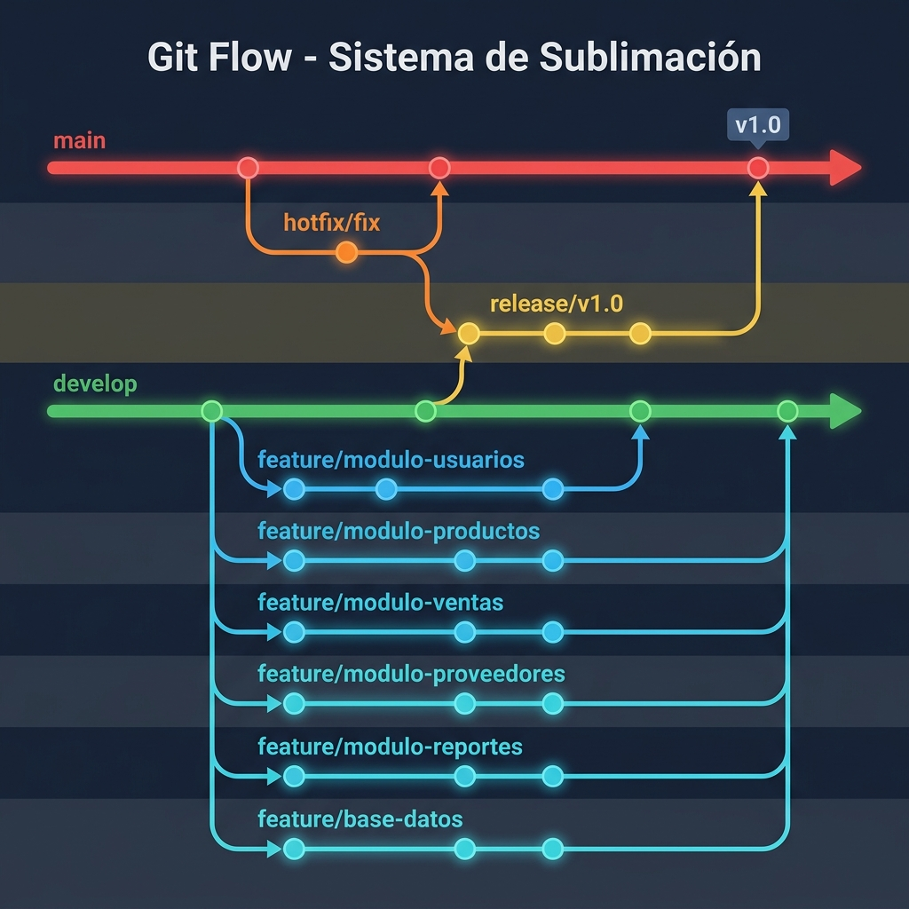

# Sistema Web de Gestión Comercial para Negocio de Sublimación 

Un sistema web enfocado en la automatización, centralización y control eficiente de las operaciones comerciales de un negocio de productos personalizados y sublimación.

---

##  Descripción del Proyecto

El crecimiento en las operaciones de los negocios de sublimación exige un control preciso sobre las ventas, la disponibilidad de insumos y la relación con los proveedores. Este proyecto surge como solución a la necesidad de abandonar los registros manuales o descentralizados para dar paso a una plataforma web integrada.

El sistema permite gestionar de manera unificada:
* Control de Ventas e Ingresos: Registro detallado de transacciones comerciales e historial de operaciones.
* Gestión de Inventarios y Recursos: Monitoreo en tiempo real de insumos críticos (tintas, papel de sublimación, prendas, tazas, consumibles) y productos terminados.
* Administración de Proveedores: Catalogo organizado de proveedores y registro de compras para optimizar la reposición de material.
* Seguridad y Control de Acceso: Gestión de usuarios con roles y permisos diferenciados, garantizando la trazabilidad de cada acción dentro del sistema.
* Reportes e Informes: Generación de consultas clave para la toma de decisiones estratégicas y financieras.

---

## Módulos del Sistema

- Usuarios: Gestión de usuarios, roles y control de acceso
- Productos: Inventario de productos e insumos
- Ventas: Registro y consulta de ventas
- Proveedores: Administración de proveedores y compras
- Reportes: Generación de informes y consultas

---

## Estructura del Proyecto

```
proyecto-sublimacion/
├── docs/                    # Documentación
├── database/                # Scripts SQL y diagramas
├── src/                     # Código fuente Django
└── tests/                   # Pruebas
```
---

##  Tecnologías Utilizadas

>
* Lenguaje de Programación: python
* Backend Framework: django framework
* Frontend Framework / Maquetación: HTML / CSS / JavaScript
* Base de Datos: sqlite
* Control de Versiones: Git / GitHub

---

## 👥 Equipo de Desarrollo

Proyecto desarrollado para la asignatura Lenguajes de Programación III por:

* [Nombre del Estudiante 1] - *Rol / Desarrollador*
* [Nombre del Estudiante 2] - *Rol / Desarrollador*
* [Nombre del Estudiante 3] - *Rol / Desarrollador*

---

##  Licencia

Este proyecto es de carácter académico y está destinado al uso exclusivo en la evaluación de la materia Lenguajes de Programación III.

---

## Git Flow

Este proyecto utiliza la estrategia de ramificación **Git Flow**:

<p align="center">
  
</p>

<p align="center">
  
</p>

 Crear las 6 feature branches desde develop
* git checkout develop
* git branch feature/modulo-usuarios
* git branch feature/modulo-productos
* git branch feature/modulo-ventas
* git branch feature/modulo-proveedores
* git branch feature/modulo-reportes
* git branch feature/base-datos
* git branch release/v1.0

 Crear hotfix desde main
* git checkout main
* git branch hotfix/fix

 Volver a develop
* git checkout develop

 Subir todas las ramas a GitHub
* git push origin --all


---
