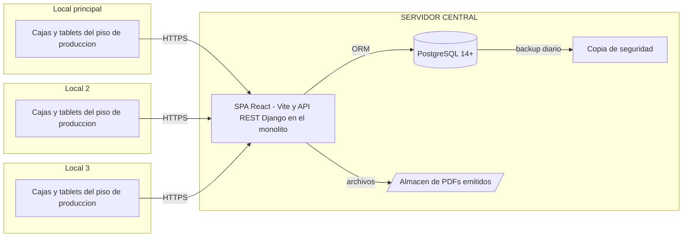
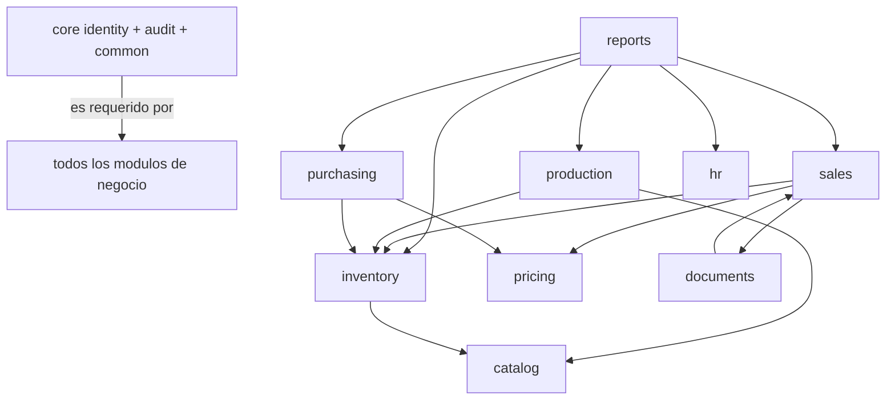

# 04 Arquitectura del monolito modular

Cómo se organiza el código Django y cómo se despliega en los 3 locales. El patrón se explica en [Monolito modular](referencias/monolito-modular.md); aquí van las decisiones concretas de DLL Sublimados. El detalle de los 11 módulos del sistema está en [01 Resumen ejecutivo](01-resumen-ejecutivo.md) y sus requerimientos, en [03 Requerimientos del sistema](03-requerimientos-del-sistema.md).

## Visión de despliegue



- El **frontend** es una SPA en React (construida con Vite, estilizada con Tailwind CSS); se sirve como estáticos y consume la **API REST en JSON** del backend.
- El **backend** es un único monolito Django con una **única base de datos** en el servidor central.
- La SPA se autentica con **JWT** (con refresh) contra el backend; todo permiso se verifica en cada endpoint del servidor, no solo en la pantalla (RNF-03).
- Los 3 locales son solo clientes por HTTPS; nada de replicación ni sincronización de datos.
- El punto individual de falla es la conexión del local: los flujos críticos (venta con stock, consumo de material) requieren estar conectado. Se asume enlace estable y se documenta como límite del sistema en primera fase.

## Estructura del repositorio

```
DLL-Sulimados---Core/
├── manage.py                # Punto de entrada de Django en la raíz (estándar)
├── requirements.txt         # Dependencias de producción
├── requirements-dev.txt     # Dependencias de desarrollo (black, flake8, pytest)
├── pyproject.toml           # Configuración de herramientas
├── docs/                    # Documentación (especificación, modelo de datos, DDL)
├── database/                # Scripts SQL
├── backend/                 # Backend monolítico modular en Django
│   ├── config/              # settings, urls de la API, asgi/wsgi
│   ├── common/              # base_models (TimeStampedModel, ActivoMixin) y utilidades
│   └── apps/                # Aplicaciones modulares del sistema
│       ├── core/            # Usuario centralizado, Local, perfiles y autenticación
│       ├── catalog/         # Materias primas, productos, servicios, categorías
│       ├── inventory/       # Stock por local, partidas, movimientos
│       ├── purchasing/      # Proveedores, órdenes y recepción de compras
│       ├── production/      # Órdenes de producción, consumo, máquinas
│       ├── sales/           # Clientes, pedidos, facturación
│       ├── pricing/         # Matriz de precios, fórmula de cotización
│       ├── hr/              # Trabajadores y cargos
│       ├── documents/       # Generador de documentos transversales
│       ├── reports/         # Dashboard y reportes por local / KPIs
│       └── audit/           # Bitácora de acciones y auditoría
├── frontend/                # SPA React + Vite + Tailwind CSS
│   ├── src/
│   │   ├── app/             # router, layout, guards y providers
│   │   ├── features/        # una carpeta por módulo: pedidos/, inventario/, produccion/...
│   │   ├── components/      # UI compartida: DataTable, ModalConfirm, SelectorLocal...
│   │   ├── services/        # cliente HTTP (axios), tokens JWT y tipo de cambio
│   │   └── hooks/           # useAuth, useLocalActivo, usePermisos
│   ├── package.json
│   └── vite.config.js
└── docker-compose.yml       # nginx (estáticos) + app Django + PostgreSQL + backup
```

> El backend vive en `backend/` con `manage.py` en la raíz del repositorio, siguiendo las mejores prácticas de Django y la arquitectura de referencia de `OptiRosse`. La SPA vive en `frontend/` y consume la API vía proxy en desarrollo. Detalle de la puesta en marcha en [13 Instalación y entorno local](13-instalacion-y-entorno-local.md).

> Dentro de cada `feature/`, la convención es la misma para los 11 módulos; el mapeo de páginas por módulo y los componentes UI están documentados en [08 Estructura del frontend](08-estructura-del-frontend.md).

## Reglas de modularidad (obligatorias para el código)

1. **Delimitación por módulo**: cada uno de los módulos tiene su `models.py`, `services.py`, `views.py`, `urls.py`, `serializers.py`, `permissions.py`, `tests.py` y `admin.py`. Nunca se tocan los modelos de otro módulo directamente.
2. **Uso obligatorio de `class Meta` en los modelos**: para garantizar el aislamiento modular en PostgreSQL, todo modelo diseñado por el Grupo de Base de Datos debe definir explícitamente `class Meta:` con su `db_table` correspondiente, evitando nombres de tablas planos ambiguos.
3. **Capa de servicios**: lo que otro módulo necesita se expone como función en `services.py` (p. ej. `inventory.services.consume_material(...)`). El consumo directo de un modelo ajeno se marca prohibido en code review.
4. **FKs entre módulos**: solo cuando el acoplamiento es del dominio (una `LineaPedido` referencia `Producto` del catálogo, y eso es correcto). Si podría ser eventualmente otro dominio, se guarda `id` sin FK.
5. **Auditoría automática**: `common` provee `TimeStampedModel` y `ActivoMixin` que escriben en la bitácora append-only de `audit`. Todas las entidades de negocio cubiertas por RNF-04 la usan.
6. **Numeración correlativa**: `common` provee un helper de secuencias por (tipo_documento, local, año) con bloqueo `SELECT ... FOR UPDATE` (RF-54).
7. Sin lógica de negocio en serializers ni en vistas de la API: reside en la capa de servicios; el frontend React solo consume y muestra.
8. **El frontend nunca decide permisos ni estados**: los estados de negocio son propiedad del backend; la SPA los muestra como badges y bloquea botones, pero el corte se valida siempre en la API.

## Dirección de dependencias



Reglas visibles en el grafo:

- `catalog`, `pricing` y `core` no dependen de otros módulos de negocio (son proveedores de datos y reglas).
- `documents` y `reports` solo leen de los demás módulos; nadie escribe hacia ellos.
- Ningún ciclo de dependencia entre módulos de negocio.

## Reutilización vía capa de servicios

| Traspaso | Función expuesta | Módulo dueño |
| --- | --- | --- |
| Venta → stock | `reserve_stock(order_line)` | `inventory` |
| Factura emitida → stock | `discount_for_sale(order_line)` | `inventory` |
| Producción → stock | `consume_material(batch, measured_uom)` | `inventory` |
| Transferencia recibida → stock | `receive_transfer(guide_id)` | `inventory` |
| Venta → precio | `quote_price(matrix_item, qty_adjustments)` | `pricing` |
| Venta → documento | `generate_document(type, ref_obj)` | `documents` |
| Producción → catálogo | `get_product_spec(product_id)` | `catalog` |

## Seguridad y permisos

- **Modelo RBAC desacoplado**: la base de datos almacena los roles (`nucleo.rol`) y su asignación (`nucleo.usuario_rol`), mientras que la matriz de permisos granulares por rol ("módulo.acción", ej. `inventory.transfer.crear`) se define directamente en código en el backend Django (`permissions.py`), garantizando control de versiones y evitando migraciones de permisos en BD.
- **Visibilidad del stock por local (respuesta directa al requerimiento)**: por defecto, **cada local solo accede a su propio stock** — todas las consultas de inventario llegan filtradas por el `local` del usuario en sesión (RF-16, RF-17). Cada local ve, además, el resumen de stock de otros locales únicamente en modo consulta (cantidad disponible del mismo material/producto, para decidir transferencias), sin poder modificarlo.
- Los usuarios con `is_global = true` (dueño, admin, gerencia) pueden cambiar de local en la barra superior e incluso ver el consolidado de los 3.
- Autenticación de la SPA con JWT; el token incluye el alcance (`local` o global) y **cada endpoint re-verifica** el alcance, sin confiar en el filtro del frontend.
- Todo permiso fallido genera evento en bitácora de `audit`, registrando la denegación sin detallar datos sensibles.

## Tecnología y ciclo de vida

| Aspecto | Decisión |
| --- | --- |
| Backend | Django 5+ (Python 3.12+) con Django REST Framework: la API en JSON que consume la SPA |
| Frontend | **React + Vite + Tailwind CSS**; SPA con router, `features` por módulo y componentes UI compartidos |
| Autenticación | JWT (p. ej. SimpleJWT) con refresh; sesión de usuario con alcance por local o global |
| Base de datos | PostgreSQL 14+ en el servidor central |
| Migraciones | Django `migrations` por app, aplicadas en orden de dependencia |
| Almacenamiento de archivos | Disco del servidor (PDFs y documentos emitidos), ruta configurada, respaldo incluido en backup |
| Despliegue | Docker Compose: nginx (estáticos de la SPA) + Django + PostgreSQL + backup |

## Referencias

- [Monolito modular](referencias/monolito-modular.md)
- [Glosario](referencias/glosario-del-negocio.md)
- [08 Estructura del frontend](08-estructura-del-frontend.md)
- [06 Modelo de datos](06-modelo-de-datos.md)
- [03 Requerimientos del sistema](03-requerimientos-del-sistema.md)