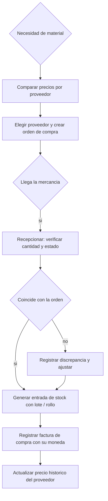
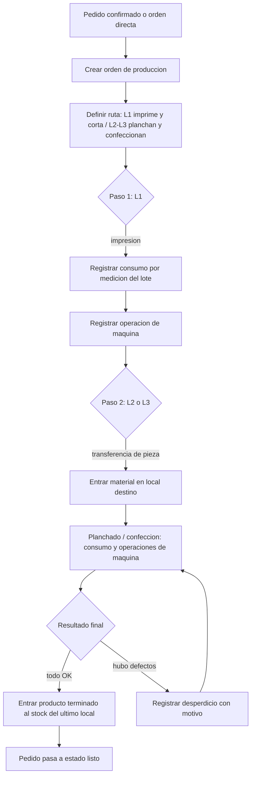
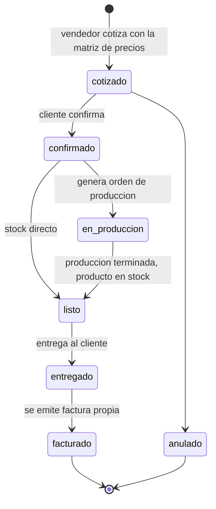
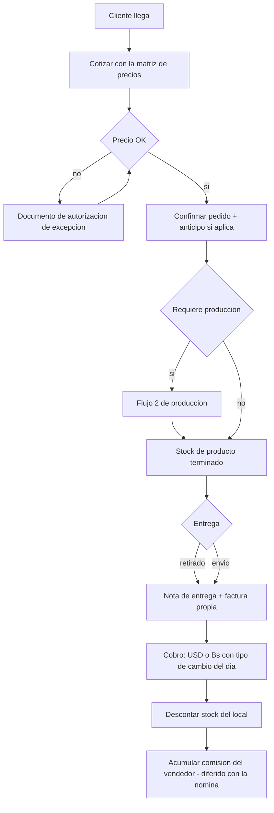
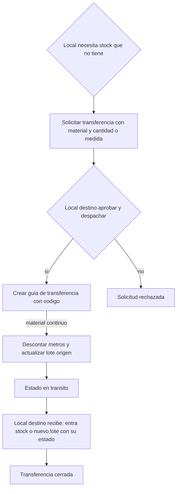
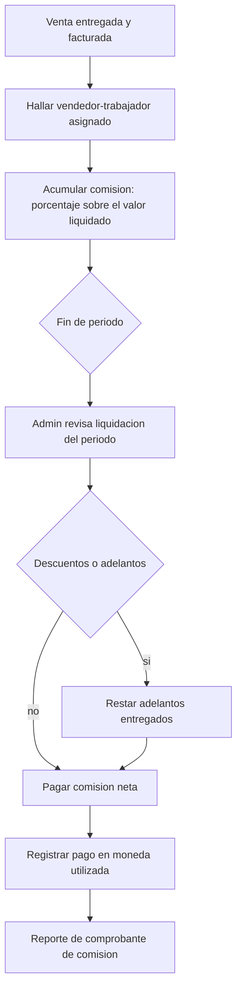
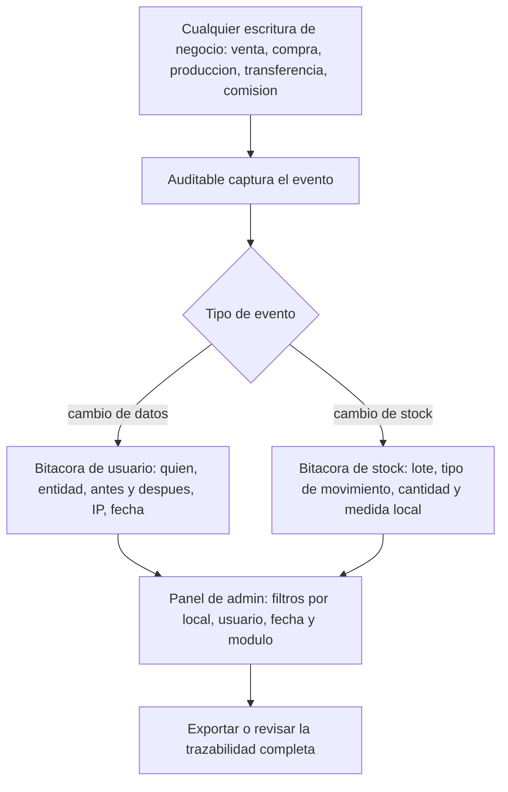

# 05 Flujos de proceso

Los 6 flujos críticos del negocio, cada uno con su diagrama Mermaid y sus pasos numerados. Están trazados a los RF de [03 Requerimientos del sistema](03-requerimientos-del-sistema.md) y usan los términos del [Glosario](referencias/glosario-del-negocio.md).

## Resumen de flujos

| Flujo | Módulos involucrados | RF |
| --- | --- | --- |
| 1. Compras | purchasing, inventory, audit | RF-25–RF-29 |
| 2. Producción multi-local | sales, production, inventory, catalog, audit | RF-30–RF-35 |
| 3. Ventas | sales, pricing, inventory, documents | RF-36–RF-43 |
| 4. Transferencias entre locales | inventory, audit | RF-21 |
| 5. Comisiones y pagos RRHH *(diferido con la nómina)* | hr, sales | RF-49, RF-50 |
| 6. Auditoría | audit, core | RF-06–RF-09 (RNF-04) |

---

## Flujo 1 — Compras

Pasos numerados:

1. El gerente del local revisa niveles mínimos o lanza la necesidad de compra.
2. Abre el **comparador**: precio histórico por material + UM + proveedor + moneda.
3. Crea la **orden de compra** (proveedor, líneas con material, cantidad y UM convenido, precio unitario).
4. Al recibir la mercancía: verifica cantidades y estados, y **entra el stock al local comprador**; para materiales continuos, se registran los lotes con su longitud/área inicial.
5. Ajusta discrepancias y emite la factura de compra, con su referencia de moneda y tipo de cambio del día.
6. El precio efectivo se guarda en el historial del proveedor: alimenta el comparador futuro.
7. Todo el ciclo deja rastro en la bitácora de stock y de usuario (audit).

---

## Flujo 2 — Producción multi-local (el más crítico)

Pasos numerados:

1. Con el pedido confirmado (o un encargo interno), producción crea la **orden de producción**, con producto, cantidad y medidas/tallas (el arte o archivo digital lo gestiona el diseñador externamente).
2. Se desprende la **ruta multi-local**: paso por local (L1: impresión y corte; L2/L3: planchado, confección, diseño) según el tipo de requerimiento.
3. Cada paso en L1 registra el **consumo por medición** sobre el lote concreto (rollo) — se anotan los metros de vinil usados en ese paso, con su código de lote.
4. Se registra el **log de máquina**: cada uso con máquina, operador, duración y resultado para indicadores futuros.
5. L1 **transfiere** al local destino la pieza cortada (flujo 4). El destino entra el stock y su lote.
6. L2/L3 planchan o confeccionan: mismo registro de consumos y de máquinas.
7. Si surge defecto, se computa **desperdicio** con motivo; si el defecto proviene de L1 (impresión defectuosa), se imputa a L1 en su respectivo paso.
8. La orden cierra: **entrada de producto terminado** al stock del último local, pedido pasa a `listo` y se reporta el costo real de ejecución (material + horas), de cara al análisis de la matriz de precios.

---

## Flujo 3 — Ventas

### Máquina de estados del pedido

El estado del pedido es la **línea de estados** por la que avanza hasta la entrega (RF-37). Cada transición queda registrada en la bitácora con el usuario que la ejecutó; el frontend la muestra como línea de progreso con badges:

> El estado `facturado` desencadena el descuento de stock y la acumulación de comisión; `anulado` revierte el stock si hubo movimiento previo.

Pasos numerados:

1. El vendedor consulta la **matriz de precios** (producto / servicio / material / medida): precio final `base × 1.30 × 1.16`. Si aplica excepción, se deja registro con justificación (audit).
2. El pedido se confirma: líneas con cantidad, medición, talla y estado `en_produccion`.
3. Si el pedido requiere producción: dispara flujo 2. Si es de stock directo, salta al paso de entrega.
4. Al estar `listo` el ítem, se genera la **nota de entrega** desde `documents` y se emite la **factura propia**, con numeración correlativa por local.
5. Se cobra en USD o Bs. con el tipo de cambio del día, y se registra el modo de cobro (punto de venta, efectivo, transferencia).
6. `sales` descuenta el stock correspondiente en el local que facturó (con registro en la bitácora de stock).
7. Al liquidar la venta, `hr` acumula la **comisión** del trabajador que atendió (flujo 5) — **diferido con la nómina**; en fase 1 solo queda registrado el `vendedor_trabajador_id`.

---

## Flujo 4 — Transferencias entre locales

Pasos numerados:

1. El local que necesita stock (material o producto) crea la **solicitud de transferencia** con material y cantidad o medida pedida.
2. El local origen revisa su stock disponible, despacha y genera la **guía interna** con código de tracking.
3. Salida del origen (para material continuo: descuenta del rollo la medida que viaja). Registro en la bitácora de stock.
4. El local destino confirma la recepción, verifica cantidades/mediciones, y refleja la entrada en su inventario (lote nuevo, estado transferida o disponible).
5. La transferencia cierra, quedando el rastro completo en bitácora (origen → tránsito → destino), visible en el panel de admin del módulo `audit`.

---

## Flujo 5 — Comisiones de trabajadores (diferido con la nómina)

> **Este flujo queda fuera del alcance de fase 1** (RF-49–RF-51 diferidos, ver [09 Decisiones diferidas y fases](09-decisiones-diferidas-y-fases.md)): se documenta como guía de diseño para la fase de nómina. La fase 1 registra solo quién vendió y quién operó cada máquina; sin acumulación de comisiones.

Pasos numerados:

1. Al cerrar la venta (estado `facturado` y `entregado`), `sales` notifica a `hr` el valor liquidado y el trabajador asignado (vendedor o productor según configuración del negocio).
2. `hr` registra el **acumulado de comisión** según el porcentaje configurado del trabajador (o el porcentaje especial del pedido).
3. Adelantos: el admin puede registrar anticipos que se restan en la liquidación.
4. Al fin de periodo (semanal, quincenal, mensual según negocio), el admin genera la **liquidación** por trabajador.
5. Pago registrado con moneda y modo; se emite el **comprobante de comisión** desde `documents`; queda auditable por trabajador, periodo y venta de origen.

---

## Flujo 6 — Auditoría continua

Pasos numerados:

1. Todos los modelos de negocio heredan de `Auditable` ([04 Arquitectura del monolito modular](04-arquitectura-del-monolito-modular.md)): la captura es automática, no manual.
2. La bitácora es **append-only**: ni el admin puede borrar ni editar registros de bitácora, solo exportarlos.
3. En el **panel de admin** se filtran los logs por (local, usuario, módulo, fecha) y se muestran las dos vistas (usuario y stock).
4. La trazabilidad cruzada permite responder preguntas de negocio: "¿quién facturó esta venta?", "¿de qué lote salió el material de esa franela?", "¿quién aprobó esa transferencia?".

## Referencias

- [Glosario](referencias/glosario-del-negocio.md)
- [03 Requerimientos del sistema](03-requerimientos-del-sistema.md)
- [04 Arquitectura del monolito modular](04-arquitectura-del-monolito-modular.md)