# 06 Modelo de datos

Modelo lógico del sistema. Cada esquema tiene su propia nota con el ERD y las notas de diseño; esta nota es el **índice**, las **convenciones de lectura** y el **MER transversal** que las conecta.

Los nombres de tablas y columnas están en español, en singular y `snake_case`; la lógica de código que no es modelo va en inglés (convención completa en [07 Convenciones de base de datos](07-convenciones-de-base-de-datos.md)).

## Convenciones de lectura

- `PK` llave primaria, `FK` llave foránea, `UK` clave única. La semántica de cada módulo procede de los RF en [03 Requerimientos del sistema](03-requerimientos-del-sistema.md).
- **Un esquema de PostgreSQL por módulo** (`nucleo`, `catalogo`, `inventario`, …): es la contrapartida física de los límites del monolito modular. Cada tabla vive en el esquema de su app Django.
- Toda tabla de negocio hereda de `Auditable` (mixins de Django): `id`, `creado_en`, `actualizado_en`, `creado_por_id`, `is_active` — no se repiten en los ERD por legibilidad.
- **FK sólida = referencia de dominio declarada** (coincide con el grafo de dependencias de [04 Arquitectura del monolito modular](04-arquitectura-del-monolito-modular.md)); `id` sin FK = referencia débil hacia otro módulo (solo el identificador).
- Montos: `NUMERIC(14, 2)` + columna `moneda` (`USD` | `BS`). Cantidades de material: `NUMERIC(12, 4)`. Detalle en [07 Convenciones de base de datos](07-convenciones-de-base-de-datos.md).
- Moneda única por transacción: se guarda el monto en la moneda del documento; el equivalente en Bs. se calcula con la `tasa_cambio` del día (nunca se duplica el monto).
- Los estados de negocio son `CHECK` en BD y `TextChoices` en Django. Los booleanos siguen el estilo Django (`is_active`, `is_global`).

> La diferencia entre este modelo y lo que hoy hay implementado en el repositorio está documentada en [12 Estado del código vs especificación](12-estado-del-codigo-vs-especificacion.md).

## Mapa módulo → esquema

| Módulo Django | Esquema PostgreSQL | Nota del modelo | Nota del DDL | Rol |
| --- | --- | --- | --- | --- |
| core.identity + core.common | `nucleo` | [06.1 nucleo](modelo-datos/06.1-nucleo.md) | [06b.1 nucleo](ddl/06b.1-nucleo.md) | locales, usuarios, roles, tasa de cambio, correlativos |
| core.audit | `auditoria` | [06.2 auditoria](modelo-datos/06.2-auditoria.md) | [06b.2 auditoria](ddl/06b.2-auditoria.md) | bitácora de acciones y de stock (append-only) |
| catalog | `catalogo` | [06.3 catalogo](modelo-datos/06.3-catalogo.md) | [06b.3 catalogo](ddl/06b.3-catalogo.md) | materiales, productos, variantes, servicios, UM, tallas |
| inventory | `inventario` | [06.4 inventario](modelo-datos/06.4-inventario.md) | [06b.4 inventario](ddl/06b.4-inventario.md) | stock, lotes, movimientos, guías de transferencia |
| purchasing | `compras` | [06.5 compras](modelo-datos/06.5-compras.md) | [06b.5 compras](ddl/06b.5-compras.md) | empresas, proveedores, órdenes, recepciones, facturas |
| production | `produccion` | [06.6 produccion](modelo-datos/06.6-produccion.md) | [06b.6 produccion](ddl/06b.6-produccion.md) | órdenes, pasos, consumos, máquinas |
| sales | `ventas` | [06.7 ventas](modelo-datos/06.7-ventas.md) | [06b.7 ventas](ddl/06b.7-ventas.md) | clientes, pedidos, líneas, cobros, facturas |
| pricing | `precios` | [06.8 precios](modelo-datos/06.8-precios.md) | [06b.8 precios](ddl/06b.8-precios.md) | matriz de precios, fórmula parametrizada |
| hr | `rrhh` | [06.9 rrhh](modelo-datos/06.9-rrhh.md) | [06b.9 rrhh](ddl/06b.9-rrhh.md) | trabajadores (catálogo de personal por local y cargo); nómina diferida |
| documents | `documentos` | [06.10 documentos](modelo-datos/06.10-documentos.md) | [06b.10 documentos](ddl/06b.10-documentos.md) | plantillas y documentos generados |
| reports | — | [06.11 reports](modelo-datos/06.11-reports.md) | [06b.11 reports](ddl/06b.11-reports.md) | sin tablas: solo consulta los otros esquemas |

## MER transversal

Relaciones principales entre los 10 esquemas (sin repetir atributos; cada nota de esquema los detalla).

```mermaid
erDiagram
    LOCAL ||--o{ STOCK : "posee"
    LOCAL ||--o{ LOTE : "guarda"
    LOCAL ||--o{ PEDIDO_VENTA : "vende en"
    LOCAL ||--o{ ORDEN_COMPRA : "compra en"
    LOCAL ||--o{ RECEPCION_COMPRA : "recibe en"
    LOCAL ||--o{ MAQUINA : "opera"
    LOCAL ||--o{ TRABAJADOR_LOCAL : "emplea"
    LOCAL ||--o{ DOCUMENTO : "numera"
    LOCAL ||--o{ NIVEL_MINIMO : "vigila"

    CLIENTE ||--o{ PEDIDO_VENTA : "realiza"
    PEDIDO_VENTA ||--|{ LINEA_PEDIDO : "detalle"
    VARIANTE_PRODUCTO ||--o{ LINEA_PEDIDO : "se vende por variante"
    SERVICIO ||--o{ LINEA_PEDIDO : "se cobra"
    PEDIDO_VENTA ||--o{ COBRO : "se cobra"
    PEDIDO_VENTA ||--o{ FACTURA : "se facturan"
    PEDIDO_VENTA ||--o{ ORDEN_PRODUCCION : "dispara"

    ORDEN_PRODUCCION ||--|{ PASO_PRODUCCION : "se descompone"
    VARIANTE_PRODUCTO ||--o{ ORDEN_PRODUCCION : "producto a fabricar"
    PASO_PRODUCCION ||--o{ CONSUMO_MATERIAL : "consume"
    LOTE ||--o{ CONSUMO_MATERIAL : "descuenta"
    LOTE ||--o{ MOVIMIENTO_STOCK : "genera"
    STOCK ||--o{ MOVIMIENTO_STOCK : "genera"
    PASO_PRODUCCION ||--o{ OPERACION_MAQUINA : "registra"
    MAQUINA ||--o{ OPERACION_MAQUINA : "ejecuta"

    EMPRESA ||--o{ PROVEEDOR : "es atendida por"
    PROVEEDOR ||--o{ ORDEN_COMPRA : "cotiza"
    ORDEN_COMPRA ||--|{ LINEA_ORDEN_COMPRA : "detalle"
    ORDEN_COMPRA ||--o{ RECEPCION_COMPRA : "se recibe"
    RECEPCION_COMPRA ||--o{ LINEA_RECEPCION_COMPRA : "genera lotes"
    LOTE ||--o{ LINEA_RECEPCION_COMPRA : "se genera"
    ORDEN_COMPRA ||--o{ FACTURA_COMPRA : "se factura"
    MATERIAL ||--o{ HISTORIAL_PRECIO_PROVEEDOR : "se cotiza"
    MATERIAL ||--o{ LOTE : "material continuo o contable"
    MATERIAL ||--o{ STOCK : "material de stock"
    VARIANTE_PRODUCTO ||--o{ STOCK : "producto de stock"

    PRODUCTO ||--o{ VARIANTE_PRODUCTO : "se tallea"
    MATERIAL ||--o{ ITEM_MATRIZ_PRECIOS : "condiciona"
    ITEM_MATRIZ_PRECIOS ||--o{ HISTORIAL_CAMBIO_PRECIO : "cambia"
    TRABAJADOR ||--o{ TRABAJADOR_LOCAL : "trabaja en"

    USUARIO ||--o{ USUARIO_ROL : "roles"
    LOCAL ||--o{ USUARIO_ROL : "permite rol por local"
    USUARIO ||--o{ BITACORA_ACCION : "emite bitacora"
    LOCAL ||--o{ BITACORA_STOCK : "contexto de bitacora"
```

## Reglas de lectura del diagrama general

1. **El `LOCAL` es el ancla transversal**: stock, lotes, pedidos, compras, recepciones, máquinas, trabajadores, documentos y roles por local cuelgan de él. Sin local no hay registro — es lo que sostiene el modelo "por local" (RF-16). Cada local ve solo sus filas por el filtro en la capa de la API, no por esquemas separados.
2. **El `MOVIMIENTO_STOCK` es el único camino que toca el stock**: cualquier entrada, salida o descuento genera un movimiento con su registro en `bitacora_stock` en la misma transacción. Ningún otro módulo escribe en `stock` ni en `lote` — lo operan solo por los servicios de `inventory`.
3. **La espina del negocio** es `PEDIDO_VENTA → ORDEN_PRODUCCION → CONSUMO_MATERIAL`: el pedido dispara la ruta por locales, cuyo consumo por medición descuenta lotes específicos.
4. **`linea_pedido` copia la foto del precio**: guarda `precio_unitario` y la referencia débil al `item_matriz` que cotizó; nunca recalcula valores.
5. **El cobro es su propia entidad**: el pedido suma cobros (parciales o totales) con método, referencia y tasa aplicada; el equivalente cambiario depende de la tasa guardada, no de la de hoy (RF-42).
6. **El `vendedor_trabajador_id` registra quién vendió** (trazabilidad de ventas↔personal, RF-48) sin cálculo monetario: la acumulación de comisiones y la nómina quedan diferidas ([09 Decisiones diferidas y fases](09-decisiones-diferidas-y-fases.md)).
7. **`DOCUMENTO` es referencia genérica** (`entidad_tipo` + `entidad_id`): acopla sin FK rígida, respetando los límites de módulo.

## Referencias

- [06b Esquemas y DDL PostgreSQL](06b-esquemas-y-ddl-postgresql.md)
- [07 Convenciones de base de datos](07-convenciones-de-base-de-datos.md)
- [04 Arquitectura del monolito modular](04-arquitectura-del-monolito-modular.md)
- [12 Estado del código vs especificación](12-estado-del-codigo-vs-especificacion.md)
- [Glosario](referencias/glosario-del-negocio.md)
