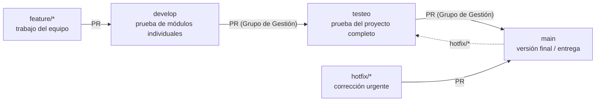
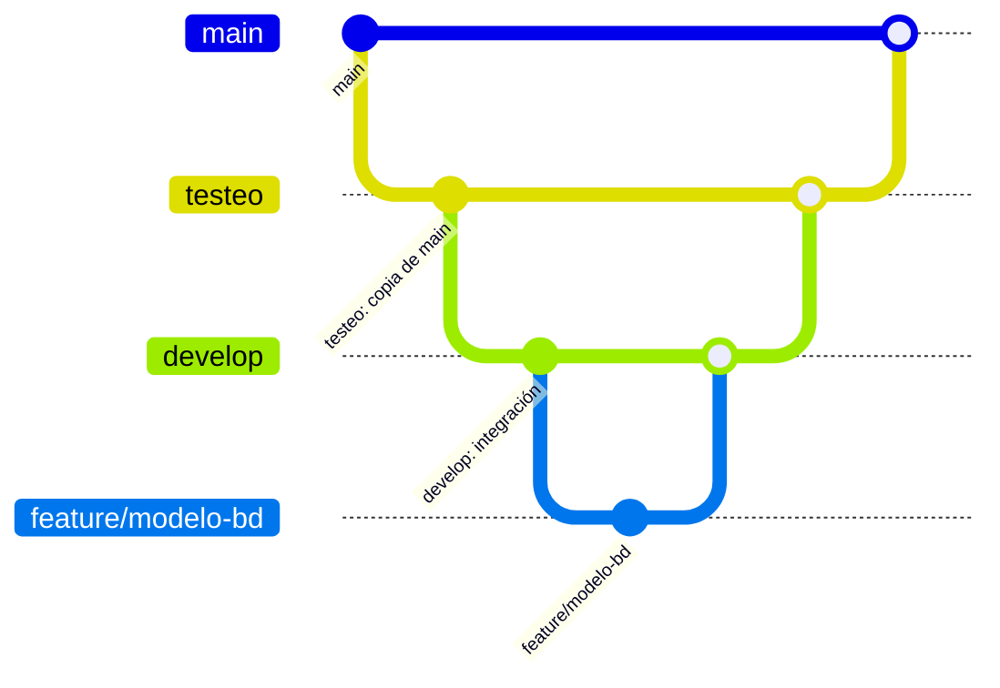

# 10 Git Flow y normas del equipo

Cómo entra el código al repositorio, qué ramas existen y qué hace cada equipo. Es la nota que traduce a reglas operativas las políticas del repositorio.

## Políticas de repositorio

Son obligatorias para los cinco grupos.

1. **Prohibición total de `commit` o `push` directo** a `main`, `testeo` o `develop` por cualquier estudiante fuera del Grupo de Gestión.
2. **Todo código entra por Pull Request.** No hay excepciones: ni un fix de una línea.
3. **Solo el Grupo de Gestión revisa y aprueba los PR.** Si un PR rompe el código actual, se rechaza de inmediato.
4. **Antes de solicitar el PR**, el desarrollador actualiza su rama local con la última versión de `develop` (`git pull origin develop`) y resuelve cualquier conflicto de fusión en su propia computadora.
5. El Grupo de Gestión es responsable de supervisar el cumplimiento del flujo de trabajo.

## Estructura de ramas

| Rama | Propósito | Origen | Destino final |
| --- | --- | --- | --- |
| `main` | Versión estable y final del proyecto (producción). | — | — |
| `testeo` | Copia de `main`. Se usa para **probar todo el proyecto integrado** antes de subir cambios a `main`. | `main` | `main` |
| `develop` | Rama de integración para **probar módulos individuales** de cada equipo. | `testeo` | `testeo` |
| `feature/*` | Ramas de trabajo de cada equipo para desarrollar funcionalidades específicas. | `develop` | `develop` |
| `hotfix/*` | Correcciones urgentes en producción. | `main` | `main` y `testeo` |

Vida útil, origen y destino de cada rama:

| Rama | Vida útil | Se crea desde | Se fusiona en |
| --- | --- | --- | --- |
| `main` | Permanente | — | — |
| `testeo` | Permanente | `main` | `main` |
| `develop` | Permanente | `testeo` | `testeo` |
| `feature/*` | Temporal | `develop` | `develop` |
| `hotfix/*` | Temporal | `main` | `main` + `testeo` |

> La rama `release/*` del Git Flow clásico **no se usa** en este proyecto: su papel (preparar y validar una entrega) lo cumple `testeo`. Ver [Git Flow](referencias/git-flow.md).

## Flujo general del proyecto





## Comandos de uso diario
### 1. Crear la rama para tu módulo (desde `develop`)

```bash
git checkout develop
git pull origin develop
git checkout -b feature/nombre-de-tu-tarea
```

Ejemplos de nombre: `feature/modelo-bd`, `feature/vistas-backend`, `feature/ui-ventas`.

### 2. Guardar y subir tu trabajo

Los mensajes de commit deben seguir estrictamente el estándar de [14 Convenciones de commits](14-convenciones-de-commits.md), incluyendo tipo, ámbito, título imperativo y desglose de cambios en el cuerpo:

```bash
git add .
git commit -m "feat(catalog): agrega clase Producto con POO" -m "- implementa modelo Producto heredando de Auditable" -m "- anade validacion de categoria y precio base" -m "- registra variantes en cascada"
git push origin feature/nombre-de-tu-tarea
```

### 3. Crear el Pull Request

- Las ramas `feature/*` hacen PR hacia `develop`.
- Una vez probados los módulos en `develop`, el **Grupo de Gestión** hace PR de `develop` hacia `testeo`.
- Al finalizar las pruebas integrales en `testeo`, el **Grupo de Gestión** hace PR de `testeo` hacia `main`.

### 4. Crear un Hotfix (solo emergencias en producción)

```bash
git checkout main
git checkout -b hotfix/solucion-error-critico
```

> Los hotfixes se fusionan tanto a `main` como a `testeo` para mantener ambas ramas sincronizadas.

## Equipos y responsabilidades

| Equipo | Responsabilidad | Módulos del sistema |
| --- | --- | --- |
| 🛡️ **Grupo de Gestión** | Administradores del repositorio (DevOps/Scrum Masters). Revisan, aceptan y fusionan el código. Supervisan el cumplimiento del flujo de trabajo. | Todos (revisión transversal) |
| 💾 **Grupo de Base de Datos** | Diseño del modelo Entidad-Relación, scripts SQL y configuración de los modelos en el motor de base de datos. | `core.common`, `core.identity`, `core.audit`, `catalog`, `inventory`, `purchasing`, `production`, `sales`, `pricing`, `hr`, `documents` |
| ⚙️ **Grupo de Backend** | Lógica de negocio, controladores (vistas de la API) y aplicación de las normas de POO. | `core.identity`, `core.audit`, `catalog`, `inventory`, `purchasing`, `production`, `sales`, `pricing`, `hr`, `documents`, `reports` |
| 🎨 **Grupo de Frontend** | Interfaces de usuario y maquetación web. | SPA (consume la API de todos los módulos) |
| 🧪 **Grupo de Testing y Calidad** | Pruebas de los módulos antes de pasar a la rama principal. | Transversal |

El reparto se hace por `feature/*`: cada grupo toma los módulos de su columna, y la integración en `develop` la coordina el Grupo de Gestión.

### Qué aporta cada grupo al flujo

- Cada grupo trabaja en su propia `feature/*`, nunca sobre `develop` directamente.
- El PR a `develop` lo abre el responsable del módulo, y lo revisa el Grupo de Gestión comprobando:
  1. Docstrings completos en clases y funciones.
  2. Cumplimiento de PEP 8 y POO.
  3. Lógica de negocio estrictamente en `services.py`.
  4. Sin variables globales ni estado compartido fuera de clases.
  5. Rama actualizada respecto a `develop` sin conflictos.
  6. Commits estructurados según Conventional Commits con título y desglose en el cuerpo (ver [14 Convenciones de commits](14-convenciones-de-commits.md)).
  7. Modelos con `class Meta` y `db_table` explícito (ver [07 Convenciones de base de datos](07-convenciones-de-base-de-datos.md)).
- `develop` es donde se prueban **módulos individuales**: si el módulo está verde, el Grupo de Gestión habilita el PR de `develop` a `testeo`.
- `testeo` es donde se prueba **el proyecto completo** (los 3 locales, la integración entre módulos, la trazabilidad de stock).
- El Grupo de Gestión hace el PR de `testeo` a `main` cuando la prueba integral pasa.

## Entorno virtual obligatorio

El uso de `venv` es obligatorio para que todos los equipos trabajen con las mismas versiones de las librerías. El detalle de los comandos está en [13 Instalación y entorno local](13-instalacion-y-entorno-local.md) y las reglas de estilo, en [11 Normas de código y POO](11-normas-de-codigo-y-poo.md).

> 💡 La carpeta `venv/` está ignorada en `.gitignore`. **Nunca se sube el entorno virtual al repositorio**, solo `requirements.txt`.

## Referencias

- [Git Flow](referencias/git-flow.md)
- [Programación Orientada a Objetos](referencias/programacion-orientada-a-objetos.md)
- [11 Normas de código y POO](11-normas-de-codigo-y-poo.md)
- [14 Convenciones de commits](14-convenciones-de-commits.md)
- [01 Resumen ejecutivo](01-resumen-ejecutivo.md)
- [09 Decisiones diferidas y fases](09-decisiones-diferidas-y-fases.md)
