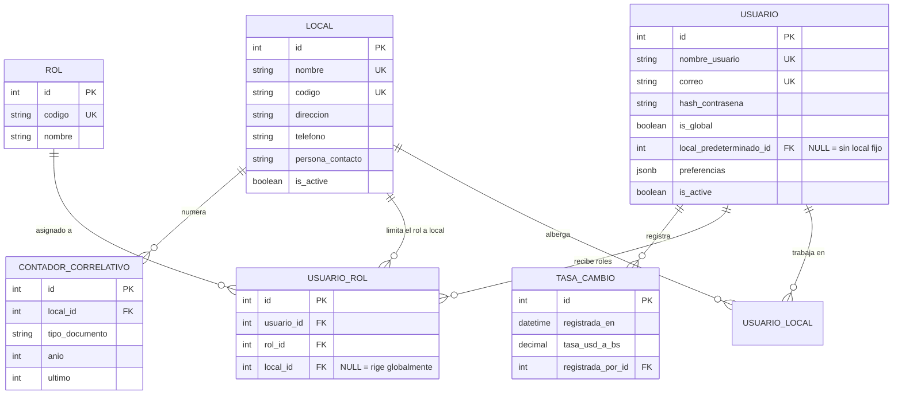

# 06.1 nucleo

Identidad y common: locales, usuarios, roles, asignaciones por local, serie del tipo de cambio y contador de correlativos. Es el esquema `nucleo`, el único que no depende de ningún módulo de negocio.

Semántica de los campos en [03 Requerimientos del sistema](../03-requerimientos-del-sistema.md) (RF-01 a RF-05).

## Notas

- **No existe columna "tipo de usuario"**: administrador, gerente u operario son roles sembrados en `nucleo.rol` con alcance global o por local (`usuario_rol`). Los permisos granulares asociados a cada rol se definen en el código del backend (Django permissions), desacoplando la BD de cambios funcionales. `is_global` declara el *alcance* (todos los locales), no la jerarquía.
- `UsuarioLocal` sostiene el modelo "mixto": un usuario puede pertenecer a uno, varios o ninguno (global).
- `preferencias` en `JSONB` guarda vistas por defecto y ajustes de UI (RF-03) sin multiplicar columnas.
- `TasaCambio` es una serie temporal: la vigente es el último registro por `registrada_en DESC`; el historial nunca se sobrescribe (RNF-05). Vive en `nucleo` porque es infraestructura común, no del dominio pricing.
- `ContadorCorrelativo` numera documentos por (tipo, local, año) con bloqueo de fila `SELECT ... FOR UPDATE` (RF-54): una columna por combinación evita duplicar números entre cajas concurrentes.

## Navegación

- Anterior: [06 Modelo de datos](../06-modelo-de-datos.md)
- Siguiente: [06.2 auditoria](06.2-auditoria.md)

## Referencias

- [06 Modelo de datos](../06-modelo-de-datos.md)
- [06b.1 nucleo](../ddl/06b.1-nucleo.md)
- [Glosario](../referencias/glosario-del-negocio.md)
- [04 Arquitectura del monolito modular](../04-arquitectura-del-monolito-modular.md)
