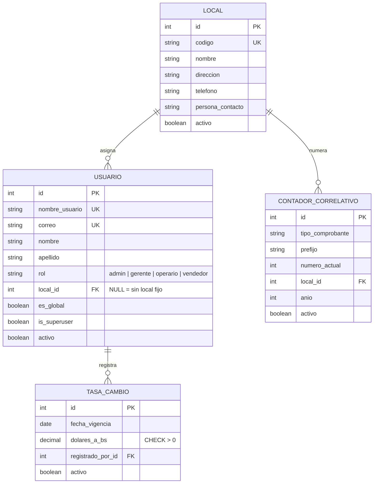

# 06.1 nucleo

Identidad y núcleo común: locales, usuarios con rol embebido y alcance multi-local, serie del tipo de cambio y contador de correlativos. Es el esquema `nucleo`, el único que no depende de ningún módulo de negocio.

Semántica de los campos en [03 Requerimientos del sistema](../03-requerimientos-del-sistema.md) (RF-01 a RF-05).

## Notas

- **Rol embebido en `nucleo.usuario`**: los roles (`admin`, `gerente`, `operario`, `vendedor`) se validan mediante `RolUsuario` (`TextChoices` + `CHECK` `core_usuario_rol_ck`) y se complementan con `PermissionsMixin` (`public.auth_group`, `nucleo.usuario_groups`, `nucleo.usuario_user_permissions`) y permisos granulares en el backend. `es_global` habilita acceso transversal a los 3 locales; `local_id` asigna el local base.
- `TasaCambio` es una serie temporal (`dolares_a_bs` con precisión `NUMERIC(14, 4)` y `CHECK > 0`): la tasa vigente es el último registro activo por `fecha_vigencia DESC, creado_en DESC` (RNF-05).
- `ContadorCorrelativo` numera comprobantes por `(tipo_comprobante, local_id, anio)` con bloqueo de fila `SELECT ... FOR UPDATE` mediante `ContadorCorrelativo.obtener_siguiente(...)` (RF-54).

## Navegación

- Anterior: [06 Modelo de datos](../06-modelo-de-datos.md)
- Siguiente: [06.2 auditoria](06.2-auditoria.md)

## Referencias

- [06 Modelo de datos](../06-modelo-de-datos.md)
- [06b.1 nucleo](../ddl/06b.1-nucleo.md)
- [Glosario](../referencias/glosario-del-negocio.md)
- [04 Arquitectura del monolito modular](../04-arquitectura-del-monolito-modular.md)
