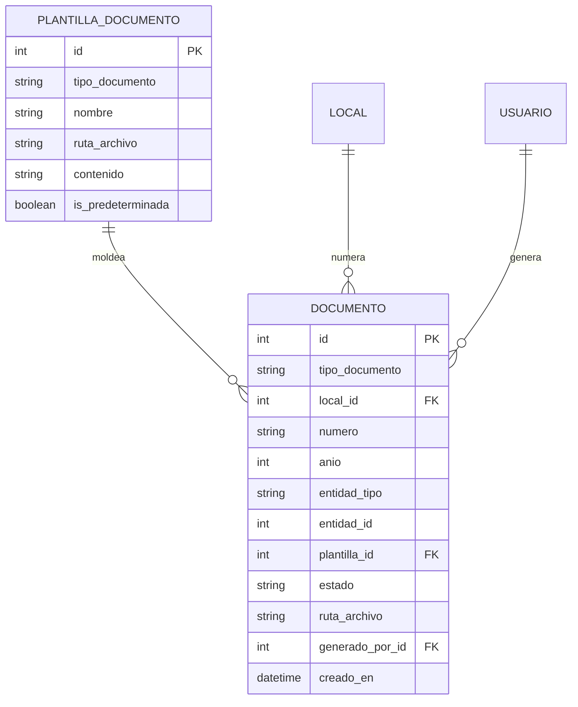

# 06.10 documentos

Generador transversal de documentos: plantillas editables y repositorio de documentos emitidos. Es el esquema `documentos`, que solo **lee** de los demás módulos.

Semántica de los campos en [03 Requerimientos del sistema](../03-requerimientos-del-sistema.md) (RF-52 a RF-55).

## Notas

- `tipo_documento`: `factura` (propia), `nota_entrega`, `orden_produccion`, `planilla_transferencia`, `acta_desperdicio`, `comprobante_comision` (diferido con la nómina, RF-52).
- **UK compuesta** `(tipo_documento, local_id, anio, numero)`: la numeración es por combinación, no global; el correlativo sale de `ContadorCorrelativo` de `nucleo` (RF-54).
- `entidad_tipo` + `entidad_id` (débil) apuntan a la instancia que originó el documento; evita FK rígidas hacia ventas, compras, producción o rrhh (los módulos consumidores no escriben aquí).
- `PlantillaDocumento` editable por el admin con logos y datos fiscales (RF-53); el PDF emitido queda en `ruta_archivo` y el repositorio se busca por (cliente, local, fecha, tipo) vía la parte referenciada (RF-55).

## Navegación

- Anterior: [06.9 rrhh](06.9-rrhh.md)
- Siguiente: [06.11 reports](06.11-reports.md)

## Referencias

- [06 Modelo de datos](../06-modelo-de-datos.md)
- [06b.10 documentos](../ddl/06b.10-documentos.md)
- [Glosario](../referencias/glosario-del-negocio.md)
- [04 Arquitectura del monolito modular](../04-arquitectura-del-monolito-modular.md)
