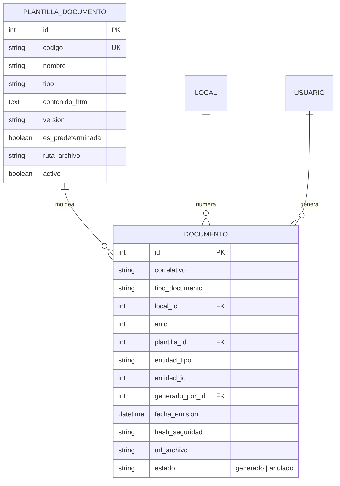

# 06.10 documentos

Generador transversal de documentos: plantillas editables y repositorio de documentos emitidos. Es el esquema `documentos`, que solo **lee** de los demás módulos.

Semántica de los campos en [03 Requerimientos del sistema](../03-requerimientos-del-sistema.md) (RF-52 a RF-55).

## Notas

- `tipo_documento` y `plantilla_documento.tipo` admiten: `factura`, `nota_entrega`, `orden_produccion`, `presupuesto`, `planilla_transferencia`, `acta_desperdicio` y `comprobante_comision` (validados por `CHECK` en PostgreSQL y `TipoDocumento` en Django).
- **UK compuesta** `(tipo_documento, local_id, anio, correlativo)`: el correlativo proviene de `nucleo.contador_correlativo` (RF-54).
- `entidad_tipo` + `entidad_id` (referencia débil) enlazan la entidad de origen sin FK rígidas entre módulos.
- `PlantillaDocumento` guarda el HTML dinámico (`contenido_html`), `version` y `es_predeterminada` (RF-53); `Documento` registra `hash_seguridad` (SHA-256) y `url_archivo` del PDF emitido (RF-55). `Documento` hereda `TimeStampedModel` (sin `ActivoMixin`, usando `estado` `'generado'` | `'anulado'`).

## Navegación

- Anterior: [06.9 rrhh](06.9-rrhh.md)
- Siguiente: [06.11 reports](06.11-reports.md)

## Referencias

- [06 Modelo de datos](../06-modelo-de-datos.md)
- [06b.10 documentos](../ddl/06b.10-documentos.md)
- [Glosario](../referencias/glosario-del-negocio.md)
- [04 Arquitectura del monolito modular](../04-arquitectura-del-monolito-modular.md)
