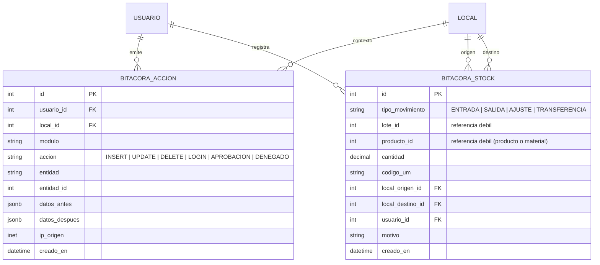

# 06.2 auditoria

Bitácora de acciones de usuario y bitácora de movimientos de stock. Ambas son **append-only** (inmutables en `save()` y `delete()` del ORM) y alimentan el panel de administración (RF-06 a RF-09, RNF-04).

## Notas

- Ambas tablas son **append-only**: sin `UPDATE` ni `DELETE` en el ORM (`PermissionDenied`) y sin columna `activo` ni `actualizado_en` (RNF-04).
- `accion` en `bitacora_accion` y `tipo_movimiento` en `bitacora_stock` están validados tanto en Django (`TextChoices`) como en PostgreSQL (`CHECK`).
- `lote_id` y `producto_id` en `bitacora_stock` se almacenan como referencias débiles (`BIGINT`) para evitar ciclos de migración y preservar el histórico aunque cambie el inventario.
- `datos_antes` / `datos_despues` en `JSONB` guardan el snapshot previo y posterior de la operación auditada.

## Navegación

- Anterior: [06.1 nucleo](06.1-nucleo.md)
- Siguiente: [06.3 catalogo](06.3-catalogo.md)

## Referencias

- [06 Modelo de datos](../06-modelo-de-datos.md)
- [06b.2 auditoria](../ddl/06b.2-auditoria.md)
- [Glosario](../referencias/glosario-del-negocio.md)
- [05 Flujos de proceso](../05-flujos-de-proceso.md)
