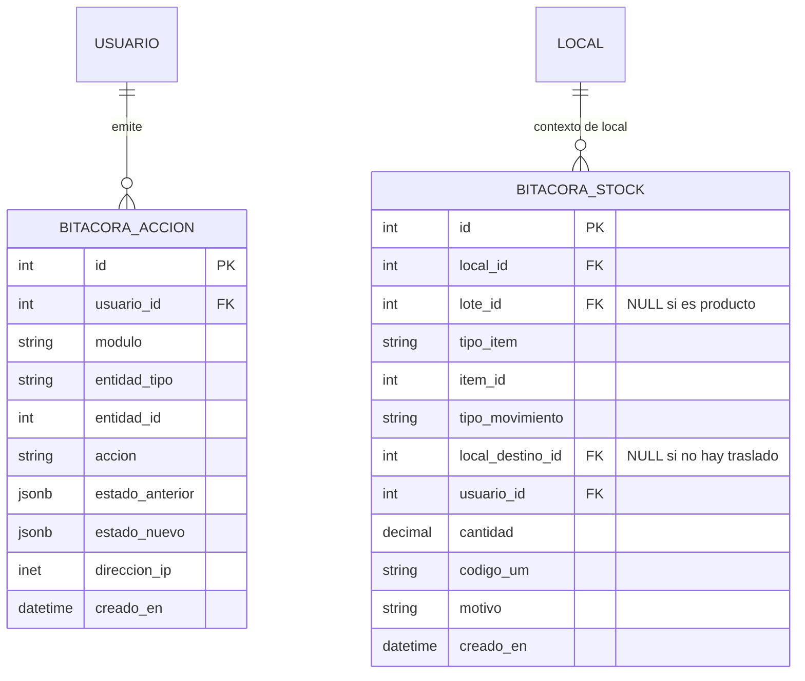

# 06.2 auditoria

Bitácora de acciones de usuario y bitácora de movimientos de stock. Ambas son **append-only** y alimentan el panel de administración (RF-06 a RF-09, RNF-04).

## Notas

- Ambas tablas son **append-only**: sin `UPDATE` ni `DELETE` por ORM ni por permisos de BD (RNF-04).
- `accion` en `bitacora_accion`: `crear`, `editar`, `borrado_logico`, `denegado` (cada permiso fallido también deja rastro).
- `tipo_item` + `item_id` hacen la referencia débil polimórfica (`material` | `variante`); `lote_id` es FK sólida solo cuando el movimiento toca un lote físico.
- `estado_anterior` / `estado_nuevo` en `JSONB` guardan el snapshot del cambio.

## Navegación

- Anterior: [06.1 nucleo](06.1-nucleo.md)
- Siguiente: [06.3 catalogo](06.3-catalogo.md)

## Referencias

- [06 Modelo de datos](../06-modelo-de-datos.md)
- [06b.2 auditoria](../ddl/06b.2-auditoria.md)
- [Glosario](../referencias/glosario-del-negocio.md)
- [05 Flujos de proceso](../05-flujos-de-proceso.md)
