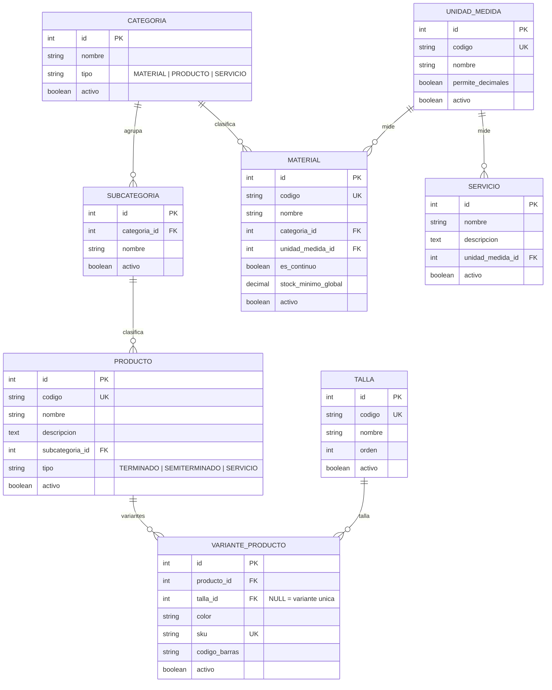

# 06.3 catalogo

Dominios y atributos del catálogo: categorías, subcategorías, unidades de medida, tallas, materias primas, productos, variantes y servicios. Es el esquema `catalogo`, proveedor de datos para inventario, ventas, producción, compras y precios.

Semántica de los campos en [03 Requerimientos del sistema](../03-requerimientos-del-sistema.md) (RF-10 a RF-15).

## Notas

- `Material.es_continuo`: identifica telas y rollos que se controlan por longitud mediante lotes (`inventario.lote`); los materiales contables se controlan directamente en `inventario.stock`.
- `Material.stock_minimo_global` (RF-15): umbral global opcional complementado por `inventario.nivel_minimo` por local.
- **Todo producto stockeable lleva al menos una variante** (`variante_producto`), aunque sea talla única (`talla_id` NULL): el stock, la producción y la venta siempre referencian variante (RF-37, RF-16).
- `Talla.orden` da el orden de presentación (`XS`, `S`, `M`, `L`, `XL`, `XXL` y tallas infantiles).
- Los diseños y artes digitales quedan fuera del catálogo del sistema (RF-12): son administrados externamente por el diseñador.

## Navegación

- Anterior: [06.2 auditoria](06.2-auditoria.md)
- Siguiente: [06.4 inventario](06.4-inventario.md)

## Referencias

- [06 Modelo de datos](../06-modelo-de-datos.md)
- [06b.3 catalogo](../ddl/06b.3-catalogo.md)
- [Glosario](../referencias/glosario-del-negocio.md)
- [03 Requerimientos del sistema](../03-requerimientos-del-sistema.md)
