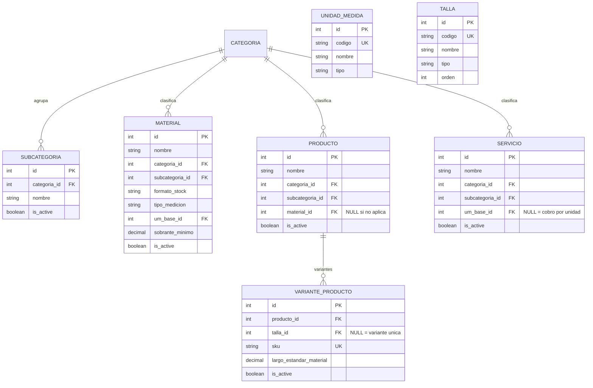

# 06.3 catalogo

Dominios y atributos del catálogo: categorías, subcategorías, materias primas, productos, variantes, servicios, unidades de medida y tallas. Es el esquema `catalogo`, proveedor de datos para inventario, ventas, producción, compras y precios.

Semántica de los campos en [03 Requerimientos del sistema](../03-requerimientos-del-sistema.md) (RF-10 a RF-15).

## Notas

- `Material.formato_stock` define la regla de consumo: `continuo` (lote obligatorio, rollo/medido) o `contable` (por unidad o lote).
- `Material.um_base_id` es la unidad en la que el material se **stockea y consume** (m, m², l, g, unidad); las conversiones (m → cm) resuelven en la capa de servicios.
- `Material.sobrante_minimo` (RF-15): debajo de ese mínimo el lote se marca como desperdicio (RF-20), en unidades de la `um_base`.
- `Producto.material_id` opcional: el material del artículo base cuando existe (la taza 11 oz, la franela de poliéster) y que condiciona la matriz de precios (RF-44).
- **Todo producto stockeable lleva al menos una variante** (`variante_producto`), aunque sea "sin talla" (`talla_id` NULL): el stock y la venta siempre referencian variante y las tallas viajan con la línea (RF-37, RF-16).
- `Talla.orden` da el orden de presentación en S, M, L, XL.
- Los diseños y artes digitales quedan fuera del catálogo del sistema: son administrados directamente por el diseñador de forma externa.

## Navegación

- Anterior: [06.2 auditoria](06.2-auditoria.md)
- Siguiente: [06.4 inventario](06.4-inventario.md)

## Referencias

- [06 Modelo de datos](../06-modelo-de-datos.md)
- [06b.3 catalogo](../ddl/06b.3-catalogo.md)
- [Glosario](../referencias/glosario-del-negocio.md)
- [03 Requerimientos del sistema](../03-requerimientos-del-sistema.md)
