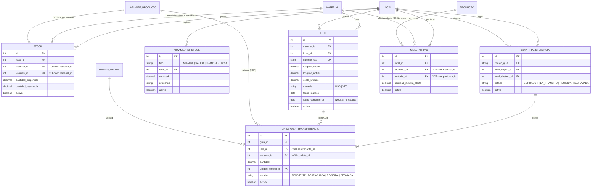

# 06.4 inventario

Stock multi-local: saldos por local, lotes trazables, movimientos, guías de transferencia con sus líneas y niveles mínimos. Es el esquema `inventario`, y el **único módulo que puede escribir en el saldo de stock**.

Semántica de los campos en [03 Requerimientos del sistema](../03-requerimientos-del-sistema.md) (RF-13 y RF-16 a RF-24).

## Notas

- **`Stock` es el saldo agregado** por `(local, material)` o `(local, variante)` con exclusión mutua `CHECK` (`inventory_stock_excluyente`) e índices únicos parciales (`inventory_stock_material_uk`, `inventory_stock_variante_uk`).
- `cantidad_reservada` acompaña a `cantidad_disponible` (RF-22): la reserva no descuenta disponible hasta el consumo real.
- **`Lote` es el objeto físico trazable** (RF-18): identifica cada rollo o partida con `numero_lote` único, `longitud_inicial`, `longitud_actual`, `costo_unitario` en `USD` o `VES`, `fecha_ingreso` y `fecha_vencimiento` opcional (RF-19, RF-23).
- **`MovimientoStock`** registra los movimientos (`ENTRADA`, `SALIDA`, `TRANSFERENCIA`) en un local con referencia de operación; la auditoría detallada de trazabilidad queda en `auditoria.bitacora_stock`.
- **`GuiaTransferencia` y `LineaGuiaTransferencia`** (RF-21): la guía valida `local_origen_id <> local_destino_id` y cada línea transporta un `lote` XOR una `variante` con su estado propio (`PENDIENTE`, `DESPACHADA`, `RECIBIDA`, `DESVIADA`).
- **`NivelMinimo`** (RF-24): define umbrales de alerta por local para un `material` XOR un `producto` con unicidad parcial por clave.

## Navegación

- Anterior: [06.3 catalogo](06.3-catalogo.md)
- Siguiente: [06.5 compras](06.5-compras.md)

## Referencias

- [06 Modelo de datos](../06-modelo-de-datos.md)
- [06b.4 inventario](../ddl/06b.4-inventario.md)
- [Glosario](../referencias/glosario-del-negocio.md)
- [05 Flujos de proceso](../05-flujos-de-proceso.md)
