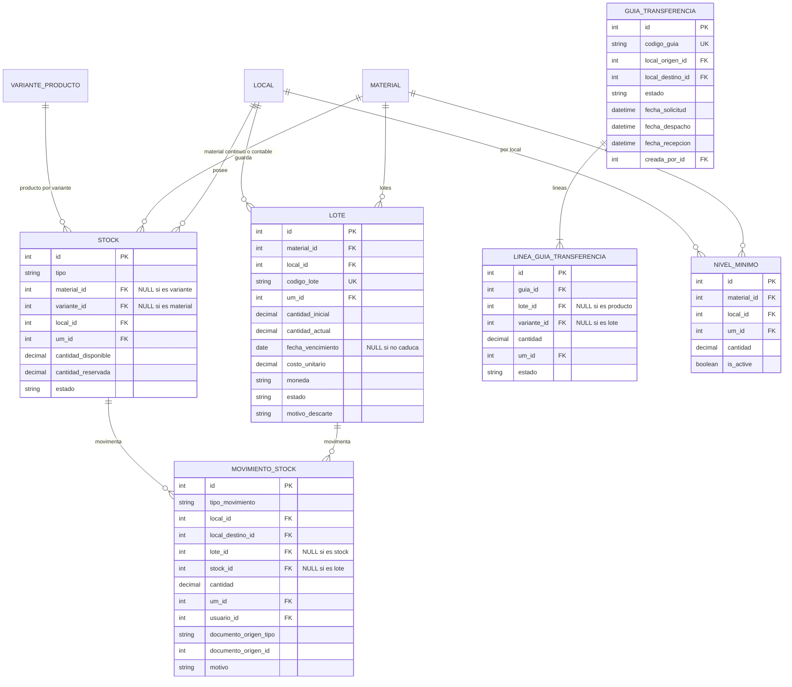

# 06.4 inventario

Stock multi-local: saldos por local, lotes trazables, movimientos, guías de transferencia y niveles mínimos. Es el esquema `inventario`, y el **único módulo que puede escribir en el saldo de stock**.

Semántica de los campos en [03 Requerimientos del sistema](../03-requerimientos-del-sistema.md) (RF-13 y RF-16 a RF-24).

## Notas

- **`Stock` es el saldo agregado** por (material o variante, local): lo que se muestra en las dos vistas de stock (RF-16, RF-17). `tipo` discrimina `material` | `producto`; el stock de producto siempre apunta a `variante_id` (nada de producto crudo, así la talla nunca se pierde en el descuento).
- `cantidad_reservada` acompaña a `cantidad_disponible` (RF-22): la reserva no descuenta disponible hasta el consumo real, pero aparece en el saldo para no vender lo mismo dos veces.
- **`Lote` es el objeto físico trazable** (RF-18): un rollo con su código, cantidad inicial y actual, costo de entrada (RF-23) y caducidad opcional (RF-19). Solo los materiales `continuo` lo requieren; los contables solo viven en `stock`.
- `Lote.costo_unitario` en la moneda de la compra: alimenta la valorización promedio ponderado (RF-23) y el costo de producción (RF-35).
- **`MovimientoStock` es el único camino que toca el stock**: `entrada_compra`, `entrada_produccion`, `entrada_transferencia`, `entrada_devolucion`, `entrada_directa`, `salida_venta`, `salida_consumo`, `salida_desperdicio`, `salida_transferencia`, `ajuste_entrada`, `ajuste_salida`, `reserva`, `liberacion_reserva`. CHECK garantiza exactamente una referencia (`lote_id` XOR `stock_id`). `documento_origen_tipo` + `documento_origen_id` (débil) apuntan al documento origen: pedido, factura, orden de producción, guía, recepción de compra.
- Cada movimiento registra además su entrada en la `bitacora_stock` de `auditoria` en la misma transacción (RNF-04).
- **`GuiaTransferencia` con líneas** (RF-21): un traslado transporta N ítems, por eso la guía se descompone en `linea_guia_transferencia` (lote físico para continuos, variante para contables), y cada línea lleva su estado de `desviada` para recepciones parcialmente fallidas. Cada traslado genera *dos* movimientos (`salida_transferencia` en origen y `entrada_transferencia` en destino).
- `NivelMinimo` por (material, local) (RF-24): el dashboard lo consulta para las alertas de stock crítico (RF-56).

## Navegación

- Anterior: [06.3 catalogo](06.3-catalogo.md)
- Siguiente: [06.5 compras](06.5-compras.md)

## Referencias

- [06 Modelo de datos](../06-modelo-de-datos.md)
- [06b.4 inventario](../ddl/06b.4-inventario.md)
- [Glosario](../referencias/glosario-del-negocio.md)
- [05 Flujos de proceso](../05-flujos-de-proceso.md)
