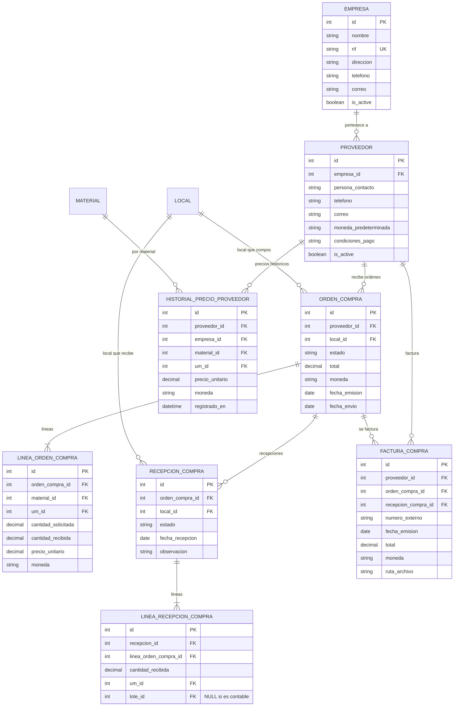

# 06.5 compras

Empresas, proveedores, órdenes de compra, recepción, facturas de compra e historial de precios. Es el esquema `compras`.

Semántica de los campos en [03 Requerimientos del sistema](../03-requerimientos-del-sistema.md) (RF-25 a RF-29).

## Notas

- **`Empresa` es la compañía que vende; `Proveedor` es el punto de contacto concreto** (varios proveedores pueden pertenecer a una misma empresa). La orden apunta al proveedor; el historial guarda ambos para que el comparador agrupe por vendedor o por empresa (RF-25, RF-28).
- El ciclo correcto: `orden → recepción (total o parcial) → entrada al stock (lote nuevo + movimiento) → factura → precio al historial`. **La recepción es el evento que dispara la entrada** (RF-26); las `cantidad_recibida` acumuladas por línea permiten recepciones parciales y detectar faltantes.
- `LineaRecepcionCompra.lote_id` enlaza la línea con el lote físico generado (solo materiales continuos): no hay entrada de lote sin recepción.
- `FacturaCompra` puede referenciar orden, recepción o ninguna (factura directa del proveedor); guarda el `numero_externo` que imprime el proveedor y su PDF/imagen adjunto (RF-27).
- Compras en la moneda elegida; el equivalente en Bs. sale de la `tasa_cambio` vigente (RF-29, RNF-05).

## Navegación

- Anterior: [06.4 inventario](06.4-inventario.md)
- Siguiente: [06.6 produccion](06.6-produccion.md)

## Referencias

- [06 Modelo de datos](../06-modelo-de-datos.md)
- [06b.5 compras](../ddl/06b.5-compras.md)
- [Glosario](../referencias/glosario-del-negocio.md)
- [05 Flujos de proceso](../05-flujos-de-proceso.md)
