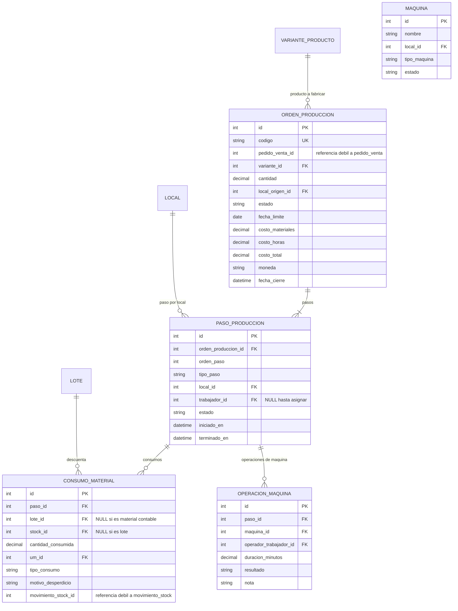

# 06.6 produccion

Órdenes de producción, ruta multi-local por pasos, consumo de material por medición, máquinas y operaciones. Es el esquema `produccion`.

Semántica de los campos en [03 Requerimientos del sistema](../03-requerimientos-del-sistema.md) (RF-30 a RF-35).

## Notas

- `OrdenProduccion` lleva el **producto** (variante), cantidad y local de origen (RF-30); origen puede ser un pedido (referencia débil) o una fabricación directa sin pedido. Los artes son administrados externamente por el diseñador.
- **Campos de costo al cierre** (RF-35): `costo_materiales` (sumatoria de consumos valorizados al costo del lote), `costo_horas` (operaciones de máquina × tarifa) y `costo_total`, con `fecha_cierre`. Es el reporte que retroalimenta la matriz de precios.
- **`PasoProduccion` es la ruta multi-local** (RF-31): pasos encadenados (`orden_paso`), cada uno con su local (impresión y corte en L1; planchado y confección en L2/L3), estado por paso y trabajador asignable. El traslado de pieza entre pasos de locales distintos pasa por la guía de transferencia (flujo 4 de [05 Flujos de proceso](../05-flujos-de-proceso.md)).
- `ConsumoMaterial` referencia el **lote concreto** (continuo) o el `stock` (contable), con `tipo_consumo` `uso` | `desperdicio` y `motivo_desperdicio` obligatorio cuando es desperdicio (RF-34). Al confirmarse el paso, se genera el movimiento que descuenta (deja el `movimiento_stock_id` débil como traza).
- `OperacionMaquina` (RF-33): máquina, operador (trabajador), duración y resultado; base para los indicadores de eficiencia de `reports`.
- `Maquina` pertenece a un local: es el catálogo de equipos de cada sede.
- La entrada de producto terminado no tiene tabla propia: es un `movimiento_stock` de tipo `entrada_produccion` sobre el stock de la variante en el último local (RF-35).

## Navegación

- Anterior: [06.5 compras](06.5-compras.md)
- Siguiente: [06.7 ventas](06.7-ventas.md)

## Referencias

- [06 Modelo de datos](../06-modelo-de-datos.md)
- [06b.6 produccion](../ddl/06b.6-produccion.md)
- [Glosario](../referencias/glosario-del-negocio.md)
- [05 Flujos de proceso](../05-flujos-de-proceso.md)
