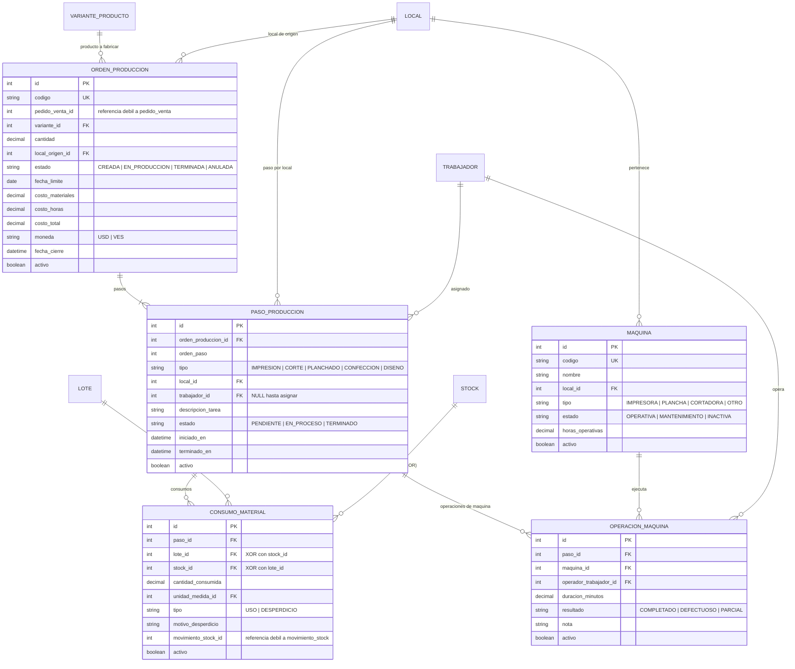

# 06.6 produccion

Órdenes de producción, ruta multi-local por pasos, consumo de material por medición, máquinas y operaciones. Es el esquema `produccion`.

Semántica de los campos en [03 Requerimientos del sistema](../03-requerimientos-del-sistema.md) (RF-30 a RF-35).

## Notas

- `OrdenProduccion` lleva el producto (`variante`), cantidad y `local_origen` (RF-30); el origen puede ser un pedido (`pedido_venta_id`, referencia débil) o fabricación directa.
- **Campos de costo al cierre** (RF-35): `costo_materiales`, `costo_horas`, `costo_total` y `fecha_cierre`. El constraint `production_oc_cierre_ck` exige `costo_total` y `fecha_cierre` no nulos cuando `estado = 'TERMINADA'`.
- **`PasoProduccion` es la ruta multi-local** (RF-31): pasos ordenados (`orden_paso > 0`, únicos por orden), con `tipo` (`IMPRESION`, `CORTE`, `PLANCHADO`, `CONFECCION`, `DISENO`), `local`, `trabajador` opcional y `descripcion_tarea`.
- `ConsumoMaterial` exige exclusión mutua estricta (`lote` XOR `stock`) y `motivo_desperdicio` obligatorio cuando `tipo = 'DESPERDICIO'` (RF-32, RF-34).
- `OperacionMaquina` (RF-33) y `Maquina` (`codigo` único, `horas_operativas`) permiten medir tiempos y eficiencia por equipo y local.

## Navegación

- Anterior: [06.5 compras](06.5-compras.md)
- Siguiente: [06.7 ventas](06.7-ventas.md)

## Referencias

- [06 Modelo de datos](../06-modelo-de-datos.md)
- [06b.6 produccion](../ddl/06b.6-produccion.md)
- [Glosario](../referencias/glosario-del-negocio.md)
- [05 Flujos de proceso](../05-flujos-de-proceso.md)
