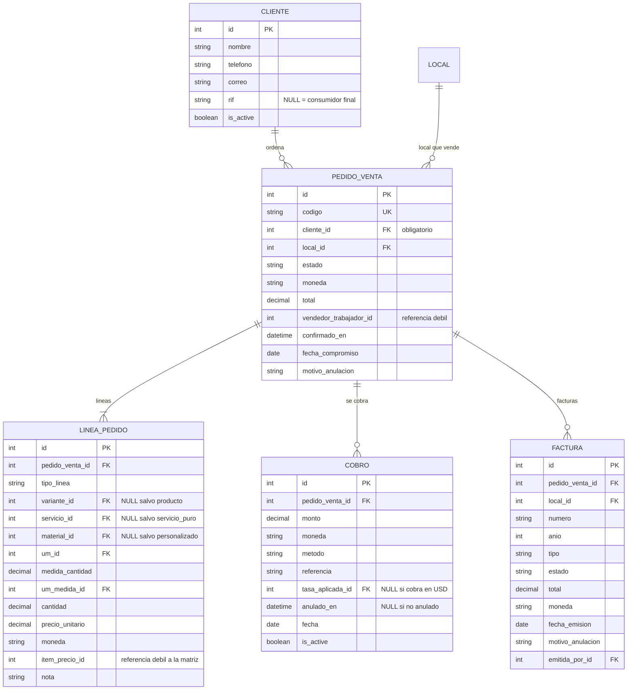

# 06.7 ventas

Clientes, pedidos, líneas, cobros y facturas propias. Es el esquema `ventas`.

Semántica de los campos en [03 Requerimientos del sistema](../03-requerimientos-del-sistema.md) (RF-36 a RF-43).

## Notas

- **El estado del pedido funciona como línea de producción por estados** (RF-37): `cotizado → confirmado → en_produccion → listo → entregado → facturado`, con `anulado` transversal. Cada transición se gana con un evento real y queda en bitácora (diagrama de estados en [05 Flujos de proceso](../05-flujos-de-proceso.md#flujo-3--ventas)).
- `cliente_id` **obligatorio**: el vendedor registra al cliente siempre; si no hay datos, se crea el genérico "consumidor final". Así el histórico por cliente (RF-36) nunca queda huérfano.
- `linea_pedido.tipo_linea` discrimina: `producto` (variante con FK obligatoria), `producto_personalizado` (variante + material + medida en su UM) y `servicio_puro` (servicio con FK obligatoria). Los CHECK de BD garantizan la coherencia de cada combinación.
- `item_precio_id` es referencia débil al ítem de la matriz que cotizó (RF-39): `precio_unitario` queda como snapshot — si la matriz cambia después, el pedido no se vuelve a recalcular. El bloqueo de precio puede exigir re-autorización (RF-39).
- `Cobro` nueva tabla (RF-42): cada cobro guarda el monto en su moneda, el **método** (efectivo | punto | transferencia | divisa), la `referencia` bancaria si existe y la `tasa_aplicada_id` cuando se cobra en Bs.; permite cobros parciales y el equivalente en la otra moneda se calcula con la tasa guardada, no con la de hoy.
- `Factura` con numeración correlativa por (local, año, numero), `motivo_anulacion` obligatorio al anular (RF-43): la anulación genera el movimiento reversa y queda en bitácora.
- `vendedor_trabajador_id` es referencia débil al trabajador de `rrhh` (el grafo de dependencias va de rrhh → sales, no al revés).
- Las notas de entrega son documentos generados por `documents` (RF-41), no tablas de ventas.

## Navegación

- Anterior: [06.6 produccion](06.6-produccion.md)
- Siguiente: [06.8 precios](06.8-precios.md)

## Referencias

- [06 Modelo de datos](../06-modelo-de-datos.md)
- [06b.7 ventas](../ddl/06b.7-ventas.md)
- [Glosario](../referencias/glosario-del-negocio.md)
- [05 Flujos de proceso](../05-flujos-de-proceso.md)
