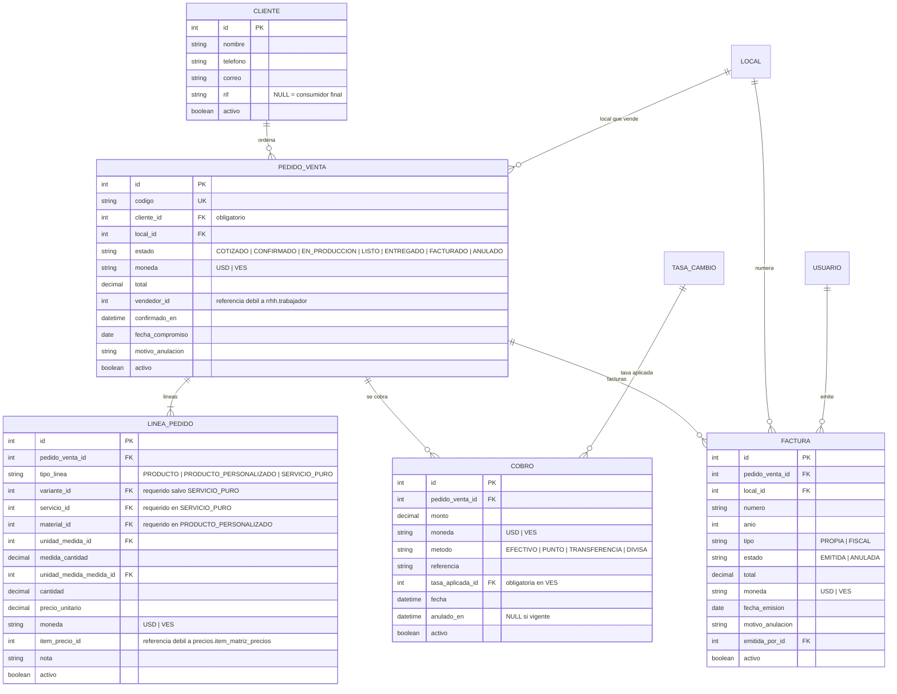

# 06.7 ventas

Clientes, pedidos, líneas, cobros y facturas propias. Es el esquema `ventas`.

Semántica de los campos en [03 Requerimientos del sistema](../03-requerimientos-del-sistema.md) (RF-36 a RF-43).

## Notas

- **El estado del pedido funciona como línea de producción por estados** (RF-37): `COTIZADO → CONFIRMADO → EN_PRODUCCION → LISTO → ENTREGADO → FACTURADO`, con `ANULADO` transversal (que exige `motivo_anulacion` no vacío vía `CHECK`, RF-43).
- `cliente_id` **obligatorio**: el consumidor sin datos se asocia al cliente genérico `"Consumidor Final"` (RF-36).
- `linea_pedido.tipo_linea` discrimina `PRODUCTO`, `PRODUCTO_PERSONALIZADO` y `SERVICIO_PURO`; los `CHECK` de BD validan la presencia de `variante`, `servicio`, `material` y el par `(medida_cantidad, unidad_medida_medida_id)`.
- `item_precio_id` es referencia débil (`db_constraint=False`) al ítem de la matriz que cotizó (RF-39): `precio_unitario` queda como snapshot.
- `Cobro` (RF-42): admite cobros parciales y multi-moneda (`USD` | `VES`); cuando `moneda = 'VES'`, el constraint `sales_cobro_tasa_bs_ck` exige `tasa_aplicada_id`. `activo = false` + `anulado_en` marcan un cobro anulado.
- `Factura` (RF-40, RF-43): correlativo único `(tipo, local_id, anio, numero)` y `motivo_anulacion` obligatorio al anular.
- `vendedor_id` es referencia débil (`db_constraint=False`) al trabajador de `rrhh`. Las notas de entrega son documentos generados por `documents` (RF-41).

## Navegación

- Anterior: [06.6 produccion](06.6-produccion.md)
- Siguiente: [06.8 precios](06.8-precios.md)

## Referencias

- [06 Modelo de datos](../06-modelo-de-datos.md)
- [06b.7 ventas](../ddl/06b.7-ventas.md)
- [Glosario](../referencias/glosario-del-negocio.md)
- [05 Flujos de proceso](../05-flujos-de-proceso.md)
