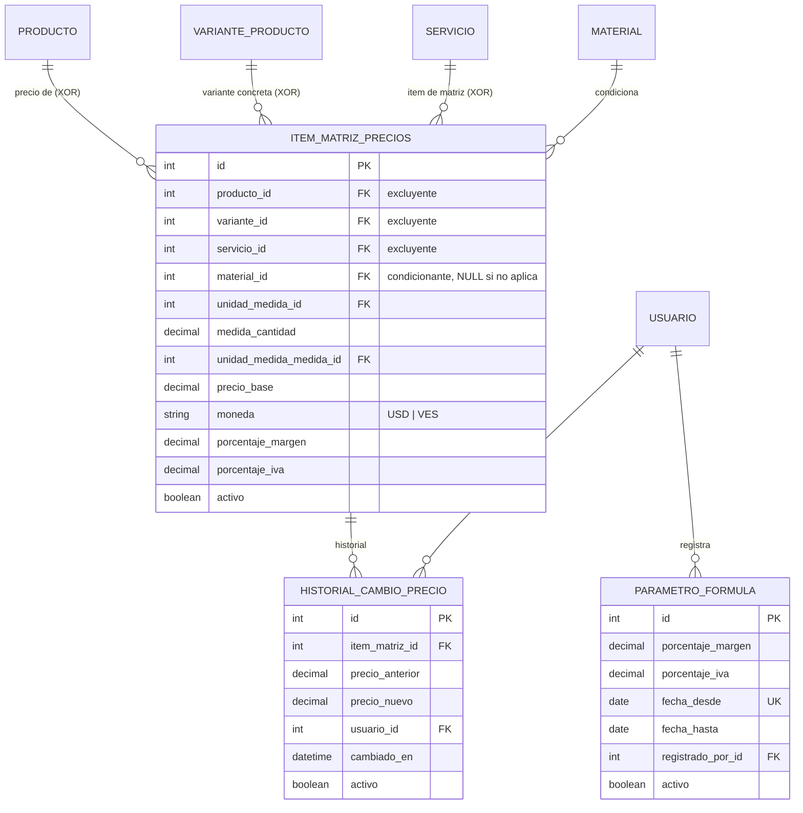

# 06.8 precios

Matriz de precios, historial de cambios y parámetros de la fórmula. Es el esquema `precios`, que no depende de ningún otro módulo de negocio: provee datos y reglas.

Semántica de los campos en [03 Requerimientos del sistema](../03-requerimientos-del-sistema.md) (RF-44 a RF-47).

## Notas

- `producto_id` / `variante_id` / `servicio_id` son **estrictamente excluyentes** (`CHECK` `pricing_item_destino_excluyente`): exactamente uno no nulo por fila.
- `medida_cantidad` + `unidad_medida_medida_id` van siempre juntos (`CHECK` `pricing_item_medida_um_ck`), permitiendo medidas comparables (ej. `11` + `oz`).
- La matriz guarda `precio_base`, `porcentaje_margen` (`> 0`) y `porcentaje_iva` (`>= 0`); el precio final (`precio_base × margen × (1 + iva)`) se calcula en servicios al cotizar y **no se persiste** (RF-44).
- `HistorialCambioPrecio` es append-only en el ORM (`save` sobre un registro existente y `delete` lanzan `PermissionDenied`, RF-46).
- `ParametroFormula` (RF-45): parametrización vigente por rango de fechas (`fecha_desde` única y `fecha_hasta > fecha_desde` cuando no es nula).

## Navegación

- Anterior: [06.7 ventas](06.7-ventas.md)
- Siguiente: [06.9 rrhh](06.9-rrhh.md)

## Referencias

- [06 Modelo de datos](../06-modelo-de-datos.md)
- [06b.8 precios](../ddl/06b.8-precios.md)
- [Glosario](../referencias/glosario-del-negocio.md)
- [03 Requerimientos del sistema](../03-requerimientos-del-sistema.md)
