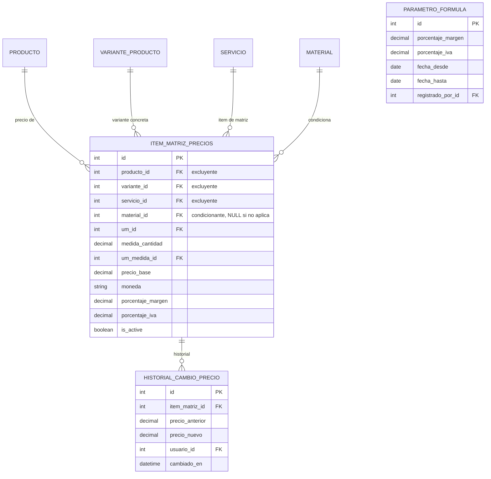

# 06.8 precios

Matriz de precios, historial de cambios y parámetros de la fórmula. Es el esquema `precios`, que no depende de ningún otro módulo de negocio: provee datos y reglas.

Semántica de los campos en [03 Requerimientos del sistema](../03-requerimientos-del-sistema.md) (RF-44 a RF-47).

## Notas

- `producto_id` / `variante_id` / `servicio_id` son **excluyentes** (CHECK): una fila describe precio de variante de producto, de producto genérico o de servicio, condicionado opcionalmente por material y medida.
- `medida_cantidad` + `um_medida_id` sustituyen al string `medida` libre: "11 oz" es una medida comparable y filtrable, no un texto que se escribe a mano.
- La matriz guarda los `precio_base`; la **fórmula** (`precio_base × margen × iva`) ocurre en la capa de servicios al cotizar y **no se persiste** como campo derivado (RF-44).
- `ParametroFormula` nueva tabla (RF-45): el margen y el IVA son parametrizables con vigencia por fechas; el precio vivo vigente es la fila con `fecha_desde <= hoy < fecha_hasta` (o la última con `fecha_hasta` NULL). Así un cambio de tasa no reescribe el pasado.

## Navegación

- Anterior: [06.7 ventas](06.7-ventas.md)
- Siguiente: [06.9 rrhh](06.9-rrhh.md)

## Referencias

- [06 Modelo de datos](../06-modelo-de-datos.md)
- [06b.8 precios](../ddl/06b.8-precios.md)
- [Glosario](../referencias/glosario-del-negocio.md)
- [03 Requerimientos del sistema](../03-requerimientos-del-sistema.md)
