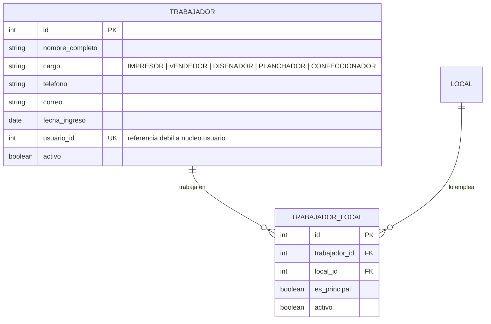

# 06.9 rrhh

Catálogo de personal: trabajadores, cargo en el negocio y asignación multi-local. Es el esquema `rrhh`, que **no** implementa la nómina en fase 1 (ver [09 Decisiones diferidas y fases](../09-decisiones-diferidas-y-fases.md)).

Semántica de los campos en [03 Requerimientos del sistema](../03-requerimientos-del-sistema.md) (RF-48 a RF-51).

## Notas

- **`Trabajador` es el empleado, no el usuario del sistema** (RF-48): si tiene acceso al sistema, `usuario_id` (`OneToOneField(..., db_constraint=False)`) lo enlaza opcionalmente a `nucleo.usuario`. `cargo` tiene `CHECK` en BD (`IMPRESOR`, `VENDEDOR`, `DISENADOR`, `PLANCHADOR`, `CONFECCIONADOR`) y alimenta producción (RF-31, RF-33).
- `TrabajadorLocal` (RF-31): un trabajador puede operar en varios locales; el índice único parcial `hr_trabajador_local_principal_uk` garantiza a lo sumo un local con `es_principal = true` por trabajador.
- **La nómina queda fuera del alcance de fase 1** (diferida, RF-49–RF-51): el diseño deja preparadas las referencias desde ventas (`pedido_venta.vendedor_id`) y producción (`paso_produccion.trabajador_id`, `operacion_maquina.operador_trabajador_id`).

## Navegación

- Anterior: [06.8 precios](06.8-precios.md)
- Siguiente: [06.10 documentos](06.10-documentos.md)

## Referencias

- [06 Modelo de datos](../06-modelo-de-datos.md)
- [06b.9 rrhh](../ddl/06b.9-rrhh.md)
- [Glosario](../referencias/glosario-del-negocio.md)
- [09 Decisiones diferidas y fases](../09-decisiones-diferidas-y-fases.md)
