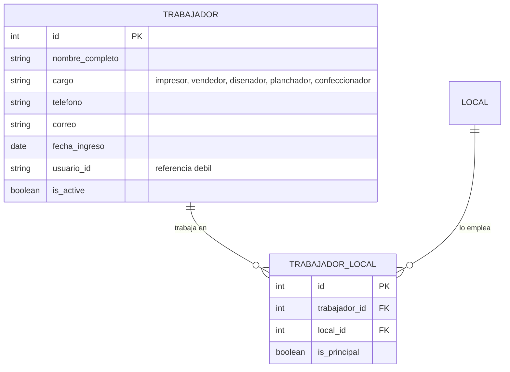

# 06.9 rrhh

Catálogo de personal: trabajadores, cargo en el negocio y asignación multi-local. Es el esquema `rrhh`, que **no** implementa la nómina en fase 1 (ver [09 Decisiones diferidas y fases](../09-decisiones-diferidas-y-fases.md)).

Semántica de los campos en [03 Requerimientos del sistema](../03-requerimientos-del-sistema.md) (RF-48 a RF-51).

## Notas

- **`Trabajador` es el empleado, no el usuario del sistema** (RF-48): si se le da login, `usuario_id` (débil, opcional) lo enlaza a `nucleo.usuario`. `cargo` declara lo que hace en el negocio y alimenta la asignación de pasos de producción (RF-31) y la trazabilidad del operador de máquina (RF-33).
- `TrabajadorLocal` (RF-31): un trabajador puede operar en varios locales (impresión en L1, confección en L2…); `is_principal` marca la sede base y hay exactamente una por trabajador.
- **La nómina queda fuera del alcance de fase 1** (diferida): configuración de comisiones, acumulación por venta, periodos de planilla, adelantos, liquidación y pagos — ver [09 Decisiones diferidas y fases](../09-decisiones-diferidas-y-fases.md). El diseño ya dejó preparado lo mínimo: `pedido_venta.vendedor_trabajador_id` (débil) y las FK de operador/vendedor de producción, de modo que el costo de incorporar la nómina luego es bajo.

## Navegación

- Anterior: [06.8 precios](06.8-precios.md)
- Siguiente: [06.10 documentos](06.10-documentos.md)

## Referencias

- [06 Modelo de datos](../06-modelo-de-datos.md)
- [06b.9 rrhh](../ddl/06b.9-rrhh.md)
- [Glosario](../referencias/glosario-del-negocio.md)
- [09 Decisiones diferidas y fases](../09-decisiones-diferidas-y-fases.md)
