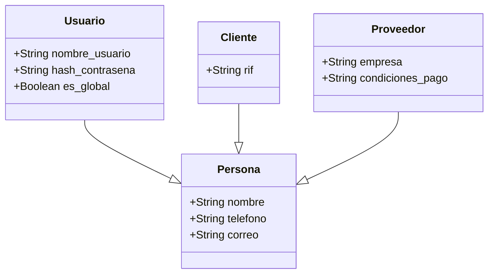

# Programación Orientada a Objetos

Paradigma de programación que organiza el sistema en objetos que combinan datos y comportamiento. En este proyecto es **obligatorio** (ver [11 Normas de código y POO](../11-normas-de-codigo-y-poo.md)).

## Los cuatro pilares y su aplicación

| Pilar | Qué significa | Cómo se aplica en Django |
| --- | --- | --- |
| **Encapsulamiento** | Los datos sensibles quedan protegidos dentro del objeto y solo se tocan por su interfaz | Modelos con `password` hasheado, montos con `MontoMonetario`, campos de negocio privados con property y setter |
| **Herencia** | Clases base que se especializan | `Auditable` como mixin abstracto; `Persona` como base de `Usuario`, `Cliente` y `Proveedor` |
| **Polimorfismo** | El mismo mensaje se comporta distinto según el tipo concreto | Un mismo método de servicio que opera sobre `material` o `variante` según el `tipo` del stock |
| **Abstracción** | Se modela el mundo real sin exponer detalles internos | `models.py` describe la entidad; `services.py` encapsula la regla de negocio; la API solo expone lo necesario |

## Herencia de personas

El negocio tiene tres entidades que comparten datos de identificación (nombre, teléfono, correo). La jerarquía propuesta es:

El estado real de esta jerarquía en el código está documentado en [12 Estado del código vs especificación](../12-estado-del-codigo-vs-especificacion.md).

## Referencias

- [11 Normas de código y POO](../11-normas-de-codigo-y-poo.md)
- [Monolito modular](monolito-modular.md)
- [04 Arquitectura del monolito modular](../04-arquitectura-del-monolito-modular.md)
